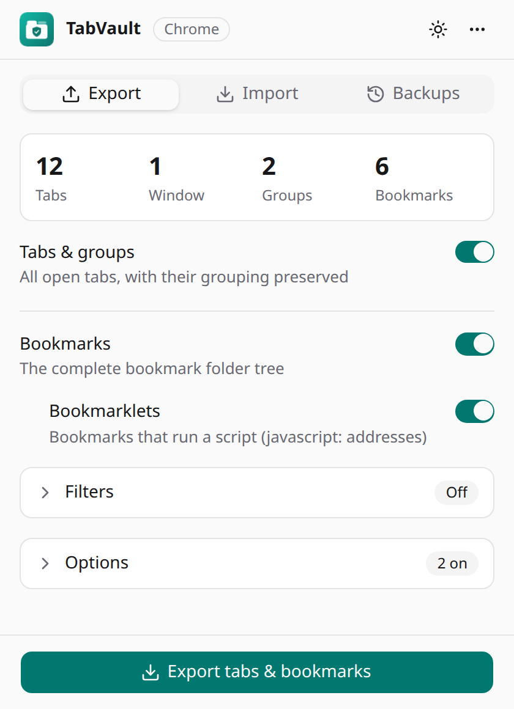
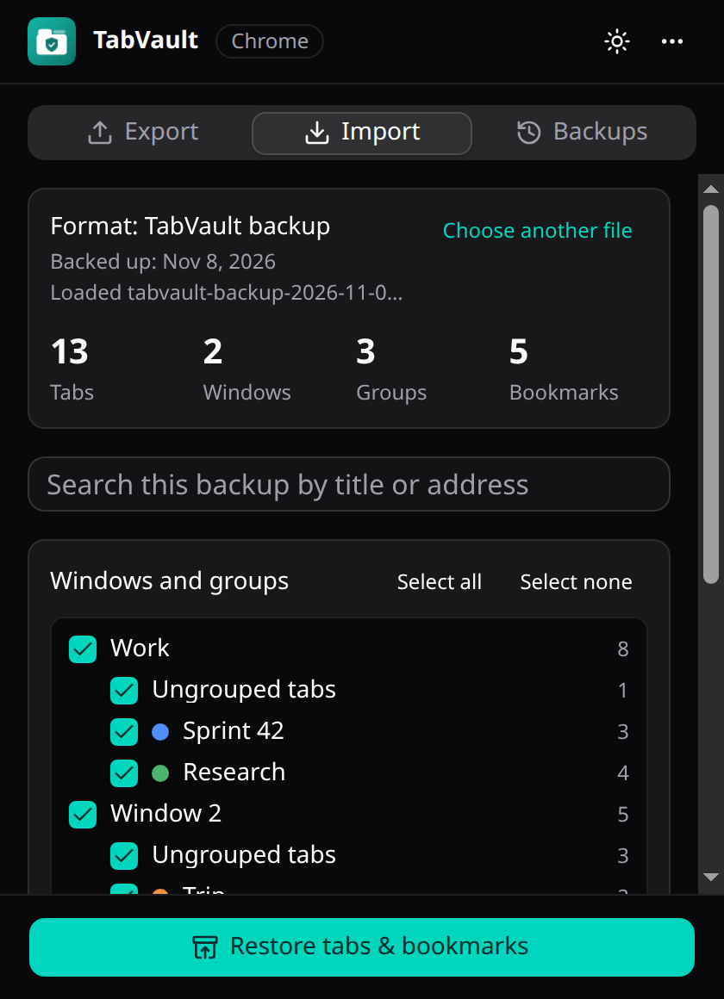
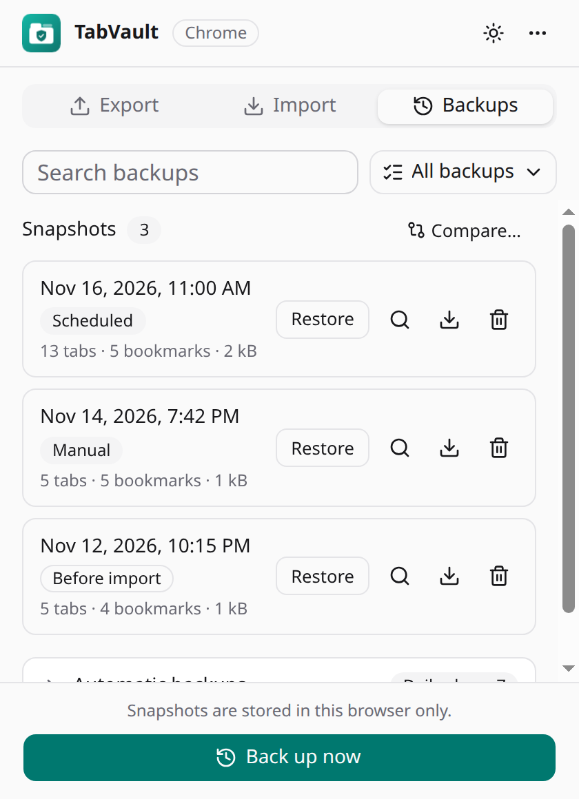
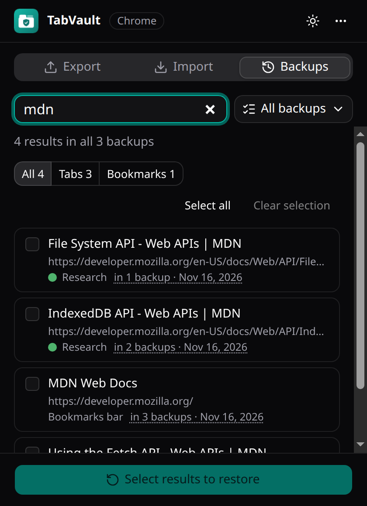

<p align="center">
  
</p>

<h1 align="center">TabVault</h1>

<p align="center">
  Back up, search and restore your tabs, tab groups and bookmarks, and move them between Chromium browsers and Firefox.
</p>

<p align="center">
  
  
  
  
</p>

## Features

- **Export** tabs, groups and bookmarks to one portable JSON file, with domain filters and
  optional window layout. Tabs from tab-suspender extensions are saved with their real address.
- **Import** TabVault backups, OneTab lists, Session Buddy backups, bookmark HTML, Firefox
  bookmark JSON or a plain list of URLs. Preview the contents, pick windows and groups, and
  restore into new windows or the current one.
- **Automatic backups**: hourly, daily or weekly snapshots, kept inside the browser and
  optionally also saved as files, to Downloads or a folder you choose.
- **Search** across all backups or inside a file, then restore only the tabs and bookmarks
  you pick.
- **Compare snapshots** to see which tabs, groups and bookmarks were added or removed.
- **Password-protected files** (PBKDF2-SHA256 with 600,000 iterations, AES-256-GCM). The
  password is never stored.
- **Quick saves** from the context menu or keyboard shortcuts (<kbd>Ctrl</kbd>+<kbd>Shift</kbd>+<kbd>.</kbd>
  back up now, <kbd>Ctrl</kbd>+<kbd>Shift</kbd>+<kbd>,</kbd> save this window).
- **Gentle restores**: tabs keep their order, pinned state and groups, and can stay unloaded
  until opened. Restores keep running in the background after the popup closes.
- **Private by design**: no network access, no analytics and no remote code.
- Light and dark themes, full keyboard support, WCAG 2.2 AA contrast.

## Supported browsers

| Browser | Status | Notes |
|---|---|---|
| Chrome, Edge, Brave, Vivaldi | ✅ | Native tab groups |
| Opera | ✅ | Workspaces are exported as groups (no API to recreate them) |
| Firefox 140+ | ✅ | Tab groups and containers; only Downloads can be used for backup files |
| Safari | ❌ | Missing the bookmarks, downloads and tab group APIs |

Browsers without tab groups get one window per group. Features are detected from the
available APIs at runtime.

## Installation

TabVault isn't in the Chrome Web Store or Firefox Add-ons yet. Until then, install it from a
release or build it yourself.

### From a release

Download the zip for your browser from the [latest release](https://github.com/xMohamd/tabvault/releases/latest):
`tabvault-<version>-chrome.zip` for Chromium browsers, `tabvault-<version>-firefox.zip` for Firefox.

**Chrome, Edge, Brave, Opera, Vivaldi**

1. Unzip the file into a folder you'll keep (the browser loads the extension from it).
2. Open the extensions page: `chrome://extensions` (Edge: `edge://extensions`, Brave:
   `brave://extensions`, Opera: `opera://extensions`, Vivaldi: `vivaldi://extensions`).
3. Turn on **Developer mode**.
4. Click **Load unpacked** and select the unzipped folder.
5. Pin TabVault from the extensions menu (puzzle icon) to keep it in the toolbar.

To update, unzip the new version over the **same folder** and click **Reload** on the extension.
Snapshots and settings are kept (the browser identifies an unpacked extension by its folder,
so loading a different folder would start fresh).

**Firefox**

1. Open `about:debugging#/runtime/this-firefox`.
2. Click **Load Temporary Add-on** and select the downloaded zip (no need to unzip it).

Firefox removes temporary add-ons when it closes, and it only installs unsigned add-ons
permanently in Firefox Developer Edition or Nightly (set `xpinstall.signatures.required` to
`false` in `about:config`, rename the zip to `.xpi`, and install it from `about:addons` → ⚙ →
**Install Add-on From File**). A permanent install in regular Firefox will come with the
Firefox Add-ons listing.

### From source

Requires Node.js 20+ and pnpm.

```bash
git clone https://github.com/xMohamd/tabvault.git
cd tabvault
pnpm install
pnpm build           # Chromium browsers -> .output/chrome-mv3
pnpm build:firefox   # Firefox           -> .output/firefox-mv3
```

Then load `.output/chrome-mv3` with **Load unpacked** as above, or in Firefox choose
`.output/firefox-mv3/manifest.json` with **Load Temporary Add-on**.

## Development

Built with [WXT](https://wxt.dev), React, TypeScript, Tailwind CSS v4 and
[shadcn/ui](https://ui.shadcn.com).

```bash
pnpm dev             # Chrome with hot reload (pnpm dev:firefox for Firefox)
pnpm check           # typecheck, unit tests, both builds and Firefox lint
pnpm zip             # store-ready zip (pnpm zip:firefox for Firefox + sources)

# Real-browser tests (CHROME must point to Chrome for Testing)
CHROME=/path/to/chrome pnpm test:e2e     # smoke test
CHROME=/path/to/chrome pnpm test:a11y    # axe accessibility audit, light and dark
pnpm test:e2e:firefox                    # real Firefox via WebDriver BiDi
```

```
src/
├── entrypoints/   background worker, popup (React) and the lazy placeholder page
├── components/ui/ shadcn/ui components
└── lib/           backup format, exporter, importer, scheduler, adapters, file formats
tests/             Vitest unit and component tests, real-browser e2e and a11y scripts
assets-src/        icon sources
```

CI runs the type check, tests, builds and lint on every push, plus the Chrome, Firefox and
accessibility tests in real browsers.

## Documentation

The [user guide](docs/user-guide.md), [architecture](docs/architecture.md),
[backup format](docs/backup-format.md), [testing](docs/testing.md), [privacy](docs/privacy.md)
and design decisions are in [docs/](docs/README.md); project terms are defined in the
[glossary](CONTEXT.md).

## About this project

TabVault is a ground-up rewrite of
[chromium-tab-migrator](https://github.com/rennerdo30/chromium-tab-migrator). It keeps the
original backup format (schema 1.1), so files work in both. On top of the original it adds a
new interface, Firefox support, automatic backups, search, snapshot comparison, encryption
and more.

The rewrite and the new features were developed with the help of AI coding tools, and are
covered by unit, end-to-end and accessibility tests in real browsers.

## Credits

Based on [chromium-tab-migrator](https://github.com/rennerdo30/chromium-tab-migrator) by
[rennerdo30](https://github.com/rennerdo30), released under the MIT License. Thanks for the
original idea, code and design.

## License

[MIT](LICENSE)
