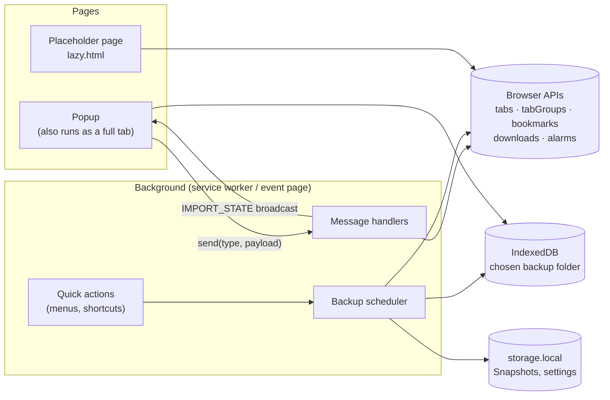
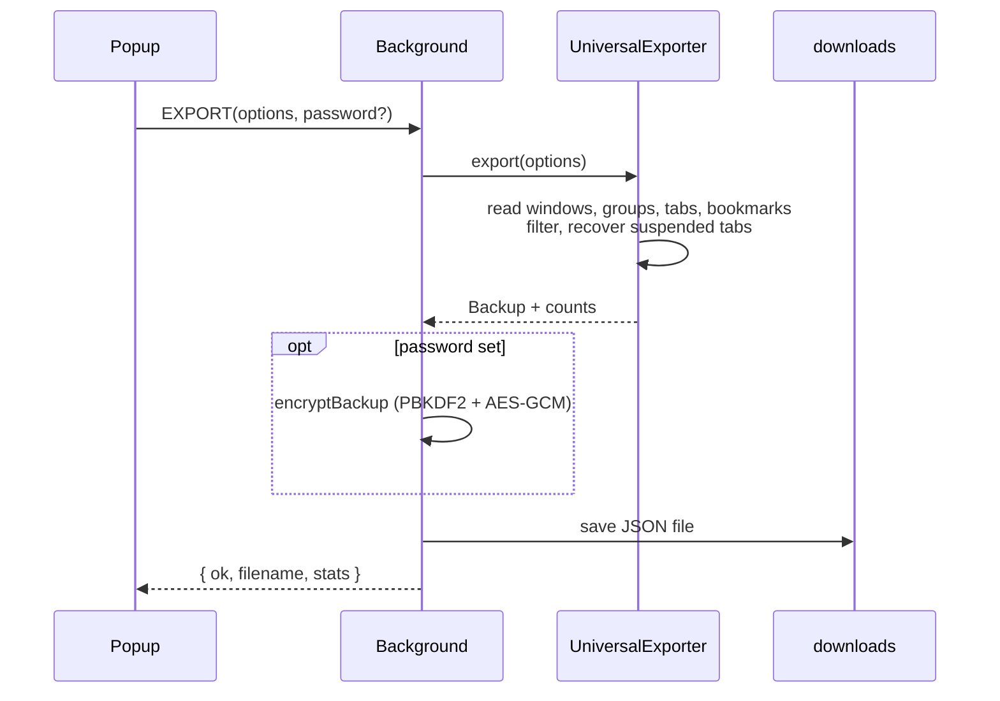
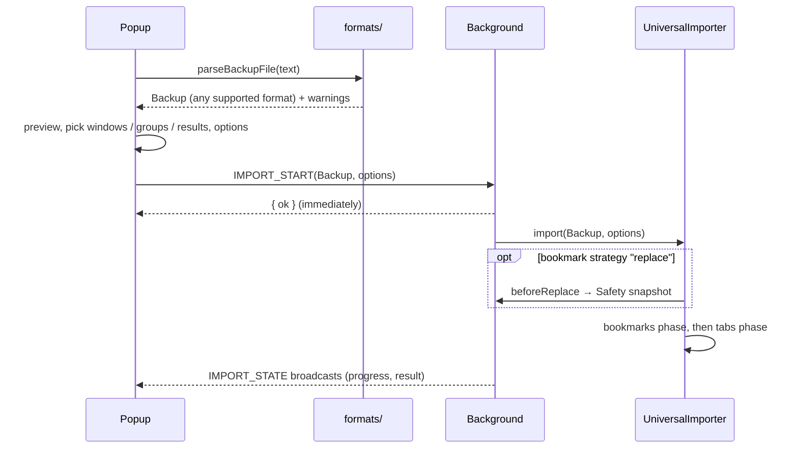

# Architecture

TabVault is a Manifest V3 extension built with [WXT](https://wxt.dev), React and TypeScript.
One codebase produces a Chromium build and a Firefox build. Terms such as Backup, Snapshot,
Import and Restore are defined in the [glossary](../CONTEXT.md).

## The parts

| Part | Where | Role |
|---|---|---|
| **Background** | `src/entrypoints/background.ts` | Owns every long or privileged task: Export, Restore, Snapshots, downloads, alarms, menus. A service worker in Chromium, an event page in Firefox. |
| **Popup** | `src/entrypoints/popup/` | The React UI: Export, Import and Backups tabs. The same page opens as a full tab (`popup.html?view=tab`) for file and folder pickers and for more room. |
| **Placeholder page** | `src/entrypoints/lazy/` | Stands in for a restored tab in the Placeholder load mode and opens the real page when the tab is first shown. |
| **Shared library** | `src/lib/` | Plain TypeScript modules used by both sides (below). |

The popup never touches tabs or bookmarks directly. It reads files, shows previews and sends
typed messages; the background does the work. This means a Restore keeps running after the
popup closes, and all browser-changing code lives in one place.

## Messages

`src/lib/types.ts` defines the protocol as one `Protocol` map: each message type has a request
and a reply shape, and `send()` (`src/lib/messaging.ts`) is typed from it. Every reply is
`{ ok: true, ... }` or `{ ok: false, error }`.

| Message | What it does |
|---|---|
| `GET_STATE` | Browser info and the current Restore state |
| `EXPORT_PREVIEW`, `EXPORT` | Count what would be exported; export to a Backup file (optionally encrypted) |
| `IMPORT_START`, `IMPORT_CANCEL`, `IMPORT_DISMISS` | Run, cancel, or clear the result of a Restore |
| `SNAPSHOTS_LIST`, `SNAPSHOT_CREATE`, `SNAPSHOT_GET`, `SNAPSHOT_DOWNLOAD`, `SNAPSHOT_DELETE` | Manage Snapshots |
| `SEARCH_SNAPSHOTS` | Search all or some Snapshots |
| `SCHEDULE_SET` | Save automatic-backup settings |
| `DIAGNOSTICS` | A support report without page addresses |

Restore progress goes the other way: the background broadcasts `{ type: 'IMPORT_STATE', state }`
and keeps the state in `storage.session`, so a reopened popup picks it up.

## Export

Snapshots use the same exporter (`backup-scheduler.ts`), store the result in `storage.local`,
and can also write a Backup file to Downloads or to a chosen folder.

## Import and Restore

**Import** happens in the popup: `src/lib/formats/` detects the file type and converts it into
a Backup, and encrypted files are decrypted there with the user's password. **Restore** happens
in the background: `importer.ts` runs the bookmarks phase (`BookmarksAdapter`) and then the tabs
phase (`TabAdapter`), reports progress, supports cancelling, and lists anything that could not
be restored with the reason.

## Library modules (`src/lib`)

| Module | Role |
|---|---|
| `schema.ts` | The [Backup format](backup-format.md): types, validation (`normalizeBackup`), counting, tab order |
| `types.ts`, `messaging.ts` | Message protocol and shared result types; typed `send()` |
| `exporter.ts` | Reads the browser into a Backup |
| `importer.ts` | Orchestrates a Restore |
| `adapters/tab-adapter.ts` | Creates windows, tabs and groups; load modes; current-window target; Firefox containers |
| `adapters/bookmarks-adapter.ts` | Bookmark strategies: merge, dated folder, replace |
| `formats/` | Import converters: OneTab, Session Buddy, bookmark HTML, Firefox bookmark JSON, URL lists |
| `backup-scheduler.ts` | Snapshots: create, list, prune, schedule (alarms), Backup files |
| `backup-folder.ts` | The chosen backup folder (File System Access handle in IndexedDB) |
| `downloads.ts` | Saves JSON through the downloads API |
| `crypto.ts` | Password-protected Backup files |
| `snapshot-search.ts`, `search-scope.ts` | Search across Backups; which Backups a search covers |
| `snapshot-diff.ts` | Compare two Snapshots |
| `quick-actions.ts` | Context menus and keyboard shortcuts |
| `browser-detect.ts` | Browser identity and feature probing |
| `url-utils.ts` | Internal pages, domain filters, suspended-tab recovery, restorability |
| `i18n.ts`, `theme.ts`, `logger.ts` | Translations and plurals, light/dark theme, structured logs |

## Where data lives

| Data | Storage |
|---|---|
| Snapshots | `storage.local`: `snapshots:index` (list) and `snapshot:<id>` (contents) |
| Automatic-backup settings, last run | `storage.local`: `autoBackup:settings`, `autoBackup:lastRun` |
| Restore progress and result | `storage.session` (falls back to `storage.local`) |
| Chosen backup folder | IndexedDB `tabvault`, see [ADR 0004](adr/0004-backup-folder-in-indexeddb.md) |
| Theme preference | the popup's `localStorage`: `tabvault:theme` |

Nothing leaves the device; see [privacy](privacy.md).

## Browser differences

Features are detected from the available APIs (`browser-detect.ts`), not from the browser name.

| | Chromium | Firefox |
|---|---|---|
| Background | Service worker | Event page |
| Saving files | `data:` URL ([ADR 0003](adr/0003-service-worker-constraints.md)) | Blob URL |
| Unloaded tabs | Created, then discarded | Created already discarded |
| Containers | — | Restored by name, created if missing |
| Backup folder | Any folder (picker) | A folder inside Downloads |
| Without tab groups | One window per group | One window per group |
